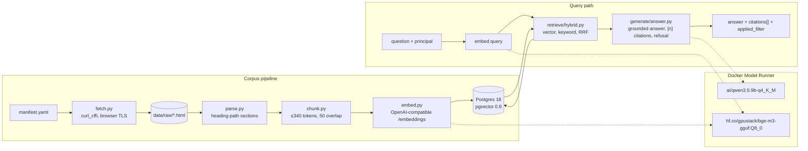
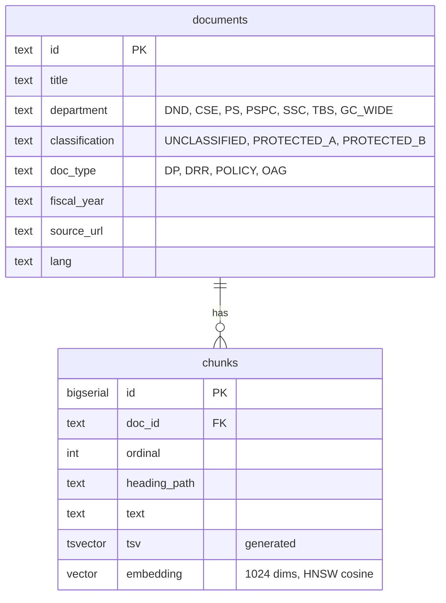

# Architecture

sovrag is a small, inspectable retrieval-augmented generation service. Every step is plain Python and every model call goes through one OpenAI-compatible client, so the inference backend is a config change.

## Components

Status: the corpus pipeline, all three retrieval modes with entitlement filtering in SQL, grounded generation with citations and refusal, and the MCP server exist. The HTTP API and the Mattermost Compose profile follow.

## Data model

Two tables. Classification and department live on `documents`; chunks carry the embedding and a generated `tsvector`. Retrieval joins the two so the entitlement predicate is a `WHERE` clause on the same query that does the similarity search.

## Principals

A principal is who is asking: an id, a clearance (`UNCLASSIFIED`, `PROTECTED_A` or `PROTECTED_B`) and a set of departments. The type and the label vocabulary live in `src/sovrag/auth/principal.py`, which the corpus manifest imports so documents and principals share one vocabulary. `GC_WIDE` is a label on documents, never a membership a principal can hold.

A `Principal` validates itself on construction, so one that exists is valid whatever built it: a non-empty string id, a `Clearance`, and a frozenset of known memberships. `LEAST_PRIVILEGED` (id `anonymous`, unclassified, no departments) is reserved for callers that authenticate but carry no recognised entitlement, and no other principal may use that id in any letter case.

`data/principals.yaml` ships five named principals, one per row of the entitlement grid: `public`, `analyst_dnd`, `analyst_ps`, `cio_ssc` and `auditor`, which holds every membership. `load_principals` reads the file strictly. A repeated id, an id YAML does not read as a string, a missing clearance, an unknown clearance or department, or a malformed shape is a `ValueError` that names the principal; nothing downgrades quietly. `resolve_principal` raises `KeyError` only for an id that is not in the file. See ADR 0012.

Like the classification labels, clearances are synthetic (ADR 0003). Both `sovrag query` and `sovrag ask` resolve `--principal` against the file `PRINCIPALS_PATH` names and reject an unknown id as a usage error.

For Mattermost users, `auth/mattermost.py` resolves a user ID to a principal with three REST calls made with the bot token: the user, which proves the ID exists and supplies the username that becomes the principal's id; the attribute field definitions; and the user's values. Only admin-managed `sovrag_clearance` and `sovrag_departments` fields count, option IDs are mapped to names through the definitions fetched in the same call, and a name outside the vocabulary is ignored. A known user with nothing recognised is bound to `LEAST_PRIVILEGED` with a note saying why. An unknown or deactivated user, a failed call, a timeout, or a reply of the wrong shape is a `ResolutionError`; a failed lookup says nothing about entitlement and is never least privilege. The audit log takes an exclusive lock around each append so the MCP server's concurrent handlers never tear a line. See ADR 0010.

## Deployment

One Compose file. Postgres and the app are services; the two models are declared in the top-level `models:` block and Docker Model Runner serves them. Compose injects `LLM_BASE_URL`, `LLM_MODEL`, `EMBED_BASE_URL` and `EMBED_MODEL` into the app container. Outside Compose, the same variables point at Model Runner's host TCP endpoint on port 12434.

Profiles add vLLM (GPU serving comparison) and the MCP server. See `docs/deployment.md` once it exists.

## Corpus

27 public documents from canada.ca, publicsafety.gc.ca and tbs-sct.canada.ca: Departmental Plans and Departmental Results Reports for five departments across two fiscal years each, four Treasury Board security policy instruments, and three Auditor General reports. After parsing and chunking: 3,357 chunks of at most 340 cl100k tokens each, so that title, heading path and text together stay under Model Runner's 512-token embedding limit (ADR 0005).

Classification labels are synthetic and derived from document type. See ADR 0003.

The vector for each chunk is computed over the document title, the heading path and the chunk text, in that order. The stored text is the bare chunk. Split documents and near-identical section headings across departments made bare-text vectors under-specify which document and year a chunk came from; the first eyeball pass showed it.

## Retrieval modes

`vector` orders chunks by cosine distance over the HNSW index. `keyword` parses the question with `websearch_to_tsquery` and ranks full-text matches with `ts_rank_cd`; a question of stop words only returns nothing. Because every term must match, sentence-length questions often return nothing from keyword mode; on a ten-question set four did. Hybrid then falls back to the vector ranking. `hybrid` takes the top `max(4k, 20)` from each and fuses by reciprocal rank fusion (k = 60), so a chunk near the top of either list rises and one near the top of both rises furthest. Ties resolve by chunk id; see ADR 0007. All three return the same `Hit` with citations. See ADR 0007.

## Entitlement filter

`retrieve/filters.py` turns a principal into an `Entitlement`: one fixed SQL fragment and two bound arrays, the classification labels at or below the clearance and the department memberships. A document is visible when its classification is at or below the clearance and it is unclassified, government-wide, or in one of the principal's departments. All three search functions require a principal and put the predicate in their `WHERE` clause; hybrid passes it to both arms and fuses only what they return. Vector search runs in a transaction with `SET LOCAL hnsw.iterative_scan = relaxed_order` so the HNSW scan continues past filtered-out rows until `k` visible ones are found, then re-sorts those `k` by score. The rendered predicate is reported as `applied_filter` on every answer and audit line. Against the indexed corpus `analyst_dnd` sees 16 of 27 documents. See ADR 0013.

## Generation

`generate/answer.py` is the single entry point for answering. It retrieves with the chosen mode, builds a prompt that lists the chunks as numbered sources, and makes one chat completion call at temperature 0 with the model's thinking mode off, and a second one only when the first reply carried no citations. The model must cite with `[n]` or reply with a sentinel; code validates the markers, builds a `Citation` for each, and turns the sentinel into a fixed refusal. An answer with no citations is retried once with a firmer instruction, then refused. Every call appends one line to the JSONL audit log. See ADR 0008.

## MCP server

`mcp/server.py` serves `search` and `answer` over Streamable HTTP for the Mattermost Agents plugin. Neither tool takes a principal. `MCP_IDENTITY` picks how it is bound, with no default: in static mode `PRINCIPAL` is resolved from the principals file when the server starts; in mattermost mode a gate in front of the MCP app answers 401 to any request without `MCP_SHARED_SECRET` as a bearer or a well-formed `X-Mattermost-UserID`, and the tool handler resolves that user's attributes once per tool call, writing a `resolve` audit event that shares a `request_id` with the `search` or `answer` event that follows. A resolution failure is a tool error and retrieves nothing. `search` runs hybrid retrieval with the bound principal and returns hits with their citation fields and the rendered filter; `answer` calls the same `answer()` the CLI uses and returns its result unchanged. See ADR 0009 and ADR 0010.

## Decisions

- ADR 0003: synthetic classification labels, assigned per document.
- ADR 0005: Docker Model Runner serves both the generator and the embedding model.
- ADR 0006: generator upgraded to Qwen 3.5 9B; embedding model held at BGE-M3 until the retrieval eval exists.
- ADR 0007: keyword ranking is Postgres `ts_rank_cd`, not BM25; hybrid fuses vector and keyword rankings by reciprocal rank fusion.
- ADR 0008: grounded answers with a refusal sentinel, code-validated citations, and a retry-then-refuse rule for uncited replies.
- ADR 0009: the server binds the principal, from configuration or from an authenticated transport it verifies; never from message text or tool arguments.
- ADR 0010: for Mattermost users, entitlement comes from admin-managed Mattermost user attributes, read once per tool call.
- ADR 0011: Mattermost runs in Compose as Mattermost Entry on the existing Postgres, with the Agents plugin pinned and Docker Model Runner as its model.
- ADR 0012: the principal model has two axes, validates itself on construction, and loads from YAML strictly.
- ADR 0013: the entitlement predicate is one bound WHERE clause inside every retrieval query; HNSW scans continue past the filter with `SET LOCAL hnsw.iterative_scan`.
