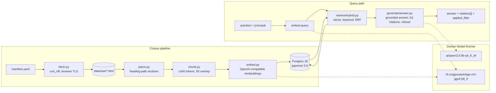
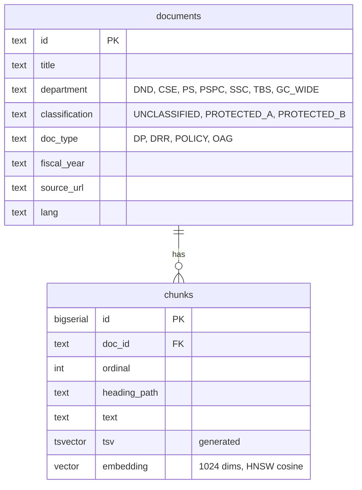

# Architecture

sovrag is a small, inspectable retrieval-augmented generation service. Every step is plain Python and every model call goes through one OpenAI-compatible client, so the inference backend is a config change.

## Components

Status: the corpus pipeline, all three retrieval modes with entitlement filtering in SQL, grounded generation with citations and refusal, the MCP server, and the Mattermost demo profile exist. Three eval suites measure retrieval, generation and leak behaviour; the retrieval and leak suites gate CI. The HTTP API serves the same answers over POST /query with the principal bound before routing.

## Data model

Two tables. Classification and department live on `documents`; chunks carry the embedding and a generated `tsvector`. Retrieval joins the two so the entitlement predicate is a `WHERE` clause on the same query that does the similarity search.

## Principals

A principal is who is asking: an id, a clearance (`UNCLASSIFIED`, `PROTECTED_A` or `PROTECTED_B`) and a set of departments. The type and the label vocabulary live in `src/sovrag/auth/principal.py`, which the corpus manifest imports so documents and principals share one vocabulary. `GC_WIDE` is a label on documents, never a membership a principal can hold.

A `Principal` validates itself on construction, so one that exists is valid whatever built it: a non-empty string id, a `Clearance`, and a frozenset of known memberships. `LEAST_PRIVILEGED` (id `anonymous`, unclassified, no departments) is reserved for callers that authenticate but carry no recognised entitlement, and no other principal may use that id in any letter case.

`data/principals.yaml` ships five named principals, one per row of the entitlement grid: `public`, `analyst_dnd`, `analyst_ps`, `cio_ssc` and `auditor`, which holds every membership. `load_principals` reads the file strictly. A repeated id, an id YAML does not read as a string, a missing clearance, an unknown clearance or department, or a malformed shape is a `ValueError` that names the principal; nothing downgrades quietly. `resolve_principal` raises `KeyError` only for an id that is not in the file. See ADR 0012.

Like the classification labels, clearances are synthetic (ADR 0003). Both `sovrag query` and `sovrag ask` resolve `--principal` against the file `PRINCIPALS_PATH` names and reject an unknown id as a usage error.

For Mattermost users, `auth/mattermost.py` resolves a user ID to a principal with three REST calls made with the bot token: the user, which proves the ID exists and supplies the username that becomes the principal's id; the attribute field definitions; and the user's values. Only admin-managed `sovrag_clearance` and `sovrag_departments` fields count, option IDs are mapped to names through the definitions fetched in the same call, and a name outside the vocabulary is ignored. A known user with nothing recognised is bound to `LEAST_PRIVILEGED` with a note saying why. An unknown or deactivated user, a failed call, a timeout, or a reply of the wrong shape is a `ResolutionError`; a failed lookup says nothing about entitlement and is never least privilege. The audit log takes an exclusive lock around each append so the MCP server's concurrent handlers never tear a line. See ADR 0010.

## Deployment

One Compose file. Postgres and the app are services; the two models are declared in the top-level `models:` block and Docker Model Runner serves them. Compose injects `LLM_BASE_URL`, `LLM_MODEL`, `EMBED_BASE_URL` and `EMBED_MODEL` into the app container. Outside Compose, the same variables point at Model Runner's host TCP endpoint on port 12434.

Profiles add vLLM (GPU serving comparison) and the MCP server. See `docs/deployment.md` once it exists.

The `mattermost` profile adds Mattermost Entry (the enterprise image with no licence key) on the same Postgres with its own role and database, and a one-shot service that creates them and revokes the default `PUBLIC` access to the sovrag database. `scripts/seed_mattermost.py` configures everything through REST: attributes, users, the Agents plugin at its pinned version, the plugin's provider and MCP server entry, the bot, and the bot token the resolver uses. See ADR 0011 and `docs/mattermost-demo.md`.

## Corpus

27 public documents from canada.ca, publicsafety.gc.ca and tbs-sct.canada.ca: Departmental Plans and Departmental Results Reports for five departments across two fiscal years each, four Treasury Board security policy instruments, and three Auditor General reports. After parsing and chunking: 3,357 chunks of at most 340 cl100k tokens each, so that title, heading path and text together stay under Model Runner's 512-token embedding limit (ADR 0005).

Classification labels are synthetic and derived from document type. See ADR 0003.

The vector for each chunk is computed over the document title, the heading path and the chunk text, in that order. The stored text is the bare chunk. Split documents and near-identical section headings across departments made bare-text vectors under-specify which document and year a chunk came from; the first eyeball pass showed it.

## Retrieval modes

`vector` orders chunks by cosine distance over the HNSW index. `keyword` parses the question with `websearch_to_tsquery` and ranks full-text matches with `ts_rank_cd`; a question of stop words only returns nothing. Because every term must match, sentence-length questions often return nothing from keyword mode; on a ten-question set four did. Hybrid then falls back to the vector ranking. `hybrid` takes the top `max(4k, 20)` from each and fuses by reciprocal rank fusion (k = 60), so a chunk near the top of either list rises and one near the top of both rises furthest. Ties resolve by chunk id; see ADR 0007. All three return the same `Hit` with citations. See ADR 0007.

## Evaluation

`sovrag eval` measures the three things a unit test cannot: whether retrieval finds the right
chunks, whether answers are faithful to what they cite, and whether a principal ever retrieves
a chunk they are not entitled to. All three read from `eval/golden/`, hand-written truth files
keyed by `(doc_id, ordinal)` rather than by anything retrieval itself produced, so the suites
grade the system against an independent answer, not against themselves. `sovrag eval
build-fixture` serialises the live index and every golden question's embedding, at full
precision, into `eval/fixture/`; `sovrag eval load-fixture` loads that committed directory into
any Postgres, so the retrieval and leak suites need no embedding model and CI measures the
index users actually query.

The **retrieval** suite searches as `auditor` in each mode with the precomputed question
embeddings and scores hit@5, recall@10 and MRR at chunk level plus hit@5 at document level,
averaged over 30 golden questions. It runs in CI against the committed fixture and is compared
to `eval/thresholds.json`; because HNSW is an approximate index, thresholds sit a small margin
below the measured baseline and may only be raised. Keyword mode is reported but not gated: it
requires every query term to match, so full-sentence questions rarely hit, which is also why
hybrid adds little over vector on this golden set. Planned-versus-actual spending tables read
almost identically across reports and differ only in numbers, so retrieval ranks them poorly;
the golden set favours narrative facts for that reason.

The **leak** suite searches 20 leak-only questions as each of the five named principals in all
three modes and asserts that no returned chunk belongs to a document that principal may not
see, using a Python restatement of the visibility rule kept independent of the SQL predicate
(ADR 0013) and tested to agree with it. This check is exact and gates CI; a positive control
run as `auditor` guards against the suite passing because the questions retrieve nothing at
all. Locally, with a model available, the same questions can also be put to `answer()` and the
refusal rate reported, not gated, because the generator may legitimately answer from visible
material that overlaps a protected fact.

The **generation** suite calls `answer()` as `auditor` in hybrid mode for every retrieval
question, then a judge model scores faithfulness to the cited chunks and correctness against
the reference answer, and separately checks the refusal rate on ten unanswerable questions; one
unanswerable question was answered with a negative statement rather than the refusal sentinel,
which the harness counts as a non-refusal. It needs a live model and a judge from a different
model family than the generator, so it runs locally rather than in CI. The judge is shown each
source labelled by the answer's own `[n]` citation marker, not by its position in the source
list, so a judge verdict is never confused by a renumbering the answer text does not use. Ten
judged answers, chosen by a fixed seed, carry an empty `human_check` field in the result file
for a person to fill; `sovrag eval agreement <result file>` reports the agreement rate between
judge and human once it is.

On the current baseline (`eval/results/generation-2026-09-22.json`, judge `ai/gemma4:12b-q4_K_M`
against generator `ai/qwen3.5:9b-q4_K_M`), all 29 judged answers were faithful
(`faithful_rate` 1.000), `correct_yes` 0.966 and `correct_no` 0.034, `false_refusal_rate` 0.033,
and 9 of the 10 unanswerable questions refused (`unanswerable_refusal_rate` 0.900).

Every suite writes one result file to `eval/results/<suite>-<date>.json`, carrying the embed,
generator and judge model names, `engine` and `engine_backend`, the metrics and the per-item
rows, so a run is never mistaken for one measured on a different backend or quantization.
`judge_model` is an empty string in the retrieval and leak result files, since no judge is
involved in those suites. See ADR 0014.

## Entitlement filter

`retrieve/filters.py` turns a principal into an `Entitlement`: one fixed SQL fragment and two bound arrays, the classification labels at or below the clearance and the department memberships. A document is visible when its classification is at or below the clearance and it is unclassified, government-wide, or in one of the principal's departments. All three search functions require a principal and put the predicate in their `WHERE` clause; hybrid passes it to both arms and fuses only what they return. Vector search runs in a transaction with `SET LOCAL hnsw.iterative_scan = relaxed_order` so the HNSW scan continues past filtered-out rows until `k` visible ones are found, then re-sorts those `k` by score. The rendered predicate is reported as `applied_filter` on every answer and audit line. Against the indexed corpus `analyst_dnd` sees 16 of 27 documents. See ADR 0013.

## Generation

`generate/answer.py` is the single entry point for answering. It retrieves with the chosen mode, builds a prompt that lists the chunks as numbered sources, and makes one chat completion call at temperature 0 with the model's thinking mode off, and a second one only when the first reply carried no citations. The model must cite with `[n]` or reply with a sentinel; code validates the markers, builds a `Citation` for each, and turns the sentinel into a fixed refusal. An answer with no citations is retried once with a firmer instruction, then refused. Every call appends one line to the JSONL audit log. See ADR 0008.

## HTTP API

`api/app.py` serves `POST /query` and `GET`/`HEAD /healthz`. `API_IDENTITY` picks how the principal is bound, with no default: in static mode `PRINCIPAL` is resolved from the principals file when the app is built and a pure-ASGI binding puts it on every request; in gateway mode a gate in front of the app answers 401 to any request without `API_SHARED_SECRET` as a bearer and a known principal id in `X-Sovrag-Principal`, resolves the id against the principals loaded at startup, and binds it, so an unknown id never reaches a handler and is never downgraded. The bearer is compared as UTF-8 bytes in constant time, so a non-ASCII token is a 401, and an empty secret refuses to start. `GET` and `HEAD /healthz` pass the gate unbound; a repeated `Authorization` or `X-Sovrag-Principal` header is a 401. The handler reads the principal from request state and from nowhere else, generates a request id, calls the same `answer()` the CLI uses, and returns its result unchanged with the id in `X-Request-ID`; a generator failure is 502 after `answer()` has written its audit line. The body cannot name a principal. See ADR 0015.

## MCP server

`mcp/server.py` serves `search` and `answer` over Streamable HTTP for the Mattermost Agents plugin. Neither tool takes a principal. `MCP_IDENTITY` picks how it is bound, with no default: in static mode `PRINCIPAL` is resolved from the principals file when the server starts; in mattermost mode a gate in front of the MCP app answers 401 to any request without `MCP_SHARED_SECRET` as a bearer or a well-formed `X-Mattermost-UserID`, or with either header repeated, and the tool handler resolves that user's attributes once per tool call, writing a `resolve` audit event that shares a `request_id` with the `search` or `answer` event that follows. A resolution failure is a tool error and retrieves nothing. `search` runs hybrid retrieval with the bound principal and returns hits with their citation fields and the rendered filter; `answer` calls the same `answer()` the CLI uses and returns its result unchanged. See ADR 0009 and ADR 0010. `tests/test_mcp_leak.py` runs the leak suite's questions through this path as each named principal and asserts zero forbidden chunks, so the gate covers the server's binding as well as the SQL predicate.

## Decisions

- ADR 0003: synthetic classification labels, assigned per document.
- ADR 0005: Docker Model Runner serves both the generator and the embedding model.
- ADR 0006: generator upgraded to Qwen 3.5 9B; embedding model held at BGE-M3 until the retrieval eval exists.
- ADR 0007: keyword ranking is Postgres `ts_rank_cd`, not BM25; hybrid fuses vector and keyword rankings by reciprocal rank fusion.
- ADR 0008: grounded answers with a refusal sentinel, code-validated citations, and a retry-then-refuse rule for uncited replies.
- ADR 0009: the server binds the principal, from configuration or from an authenticated transport it verifies; never from message text or tool arguments.
- ADR 0010: for Mattermost users, entitlement comes from admin-managed Mattermost user attributes, read once per tool call.
- ADR 0011: Mattermost runs in Compose as Mattermost Entry on the existing Postgres, with the Agents plugin pinned and Docker Model Runner as its model.
- ADR 0012: the principal model has two axes, validates itself on construction, and loads from YAML strictly.
- ADR 0013: the entitlement predicate is one bound WHERE clause inside every retrieval query; HNSW scans continue past the filter with `SET LOCAL hnsw.iterative_scan`.
- ADR 0014: evaluation design: committed full-precision fixture, hand-written gold, an independent leak oracle, a judge from another model family, labelled results.
- ADR 0015: the HTTP API binds its principal like the MCP server, static or from a verified gateway; one query endpoint; 401 never downgrades.
