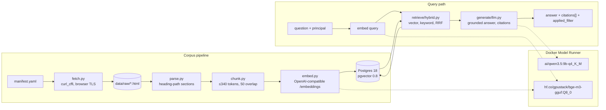
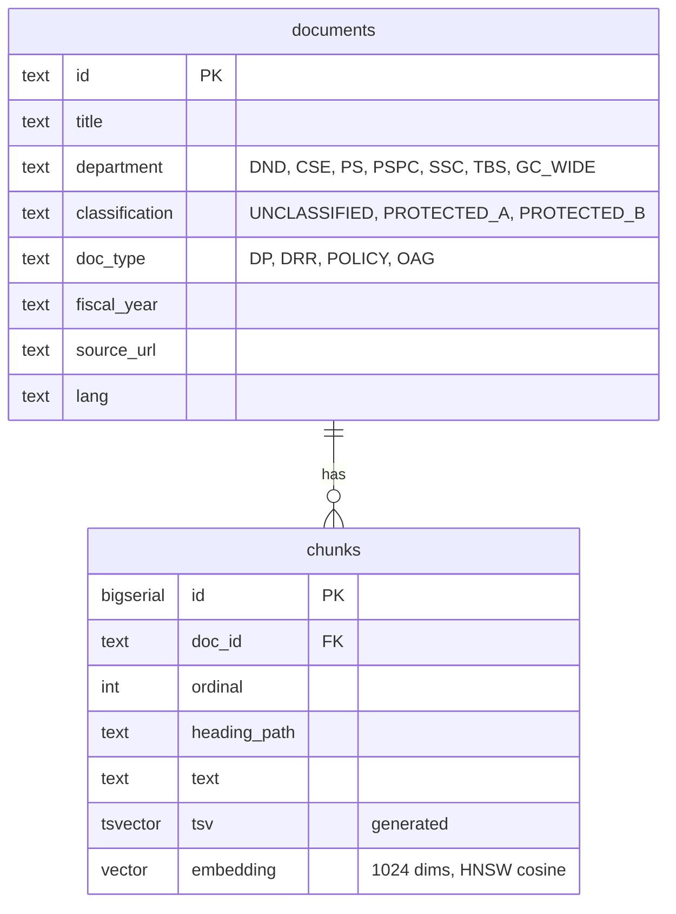

# Architecture

sovrag is a small, inspectable retrieval-augmented generation service. Every step is plain Python and every model call goes through one OpenAI-compatible client, so the inference backend is a config change.

## Components

Status: the corpus pipeline and all three retrieval modes exist. Generation, entitlement filtering and the HTTP API follow.

## Data model

Two tables. Classification and department live on `documents`; chunks carry the embedding and a generated `tsvector`. Retrieval joins the two so the entitlement predicate is a `WHERE` clause on the same query that does the similarity search.

## Deployment

One Compose file. Postgres and the app are services; the two models are declared in the top-level `models:` block and Docker Model Runner serves them. Compose injects `LLM_BASE_URL`, `LLM_MODEL`, `EMBED_BASE_URL` and `EMBED_MODEL` into the app container. Outside Compose, the same variables point at Model Runner's host TCP endpoint on port 12434.

Profiles add vLLM (GPU serving comparison) and the MCP server. See `docs/deployment.md` once it exists.

## Corpus

27 public documents from canada.ca, publicsafety.gc.ca and tbs-sct.canada.ca: Departmental Plans and Departmental Results Reports for five departments across two fiscal years each, four Treasury Board security policy instruments, and three Auditor General reports. After parsing and chunking: 3,357 chunks of at most 340 cl100k tokens each, so that title, heading path and text together stay under Model Runner's 512-token embedding limit (ADR 0005).

Classification labels are synthetic and derived from document type. See ADR 0003.

The vector for each chunk is computed over the document title, the heading path and the chunk text, in that order. The stored text is the bare chunk. Split documents and near-identical section headings across departments made bare-text vectors under-specify which document and year a chunk came from; the first eyeball pass showed it.

## Retrieval modes

`vector` orders chunks by cosine distance over the HNSW index. `keyword` parses the question with `websearch_to_tsquery` and ranks full-text matches with `ts_rank_cd`; a question of stop words only returns nothing. `hybrid` takes the top `max(4k, 20)` from each and fuses by reciprocal rank fusion (k = 60), so a chunk near the top of either list rises and one near the top of both rises furthest. All three return the same `Hit` with citations. See ADR 0007.

## Decisions

- ADR 0003: synthetic classification labels, assigned per document.
- ADR 0005: Docker Model Runner serves both the generator and the embedding model.
- ADR 0006: generator upgraded to Qwen 3.5 9B; embedding model held at BGE-M3 until the retrieval eval exists.
- ADR 0007: keyword ranking is Postgres `ts_rank_cd`, not BM25; hybrid fuses vector and keyword rankings by reciprocal rank fusion.
